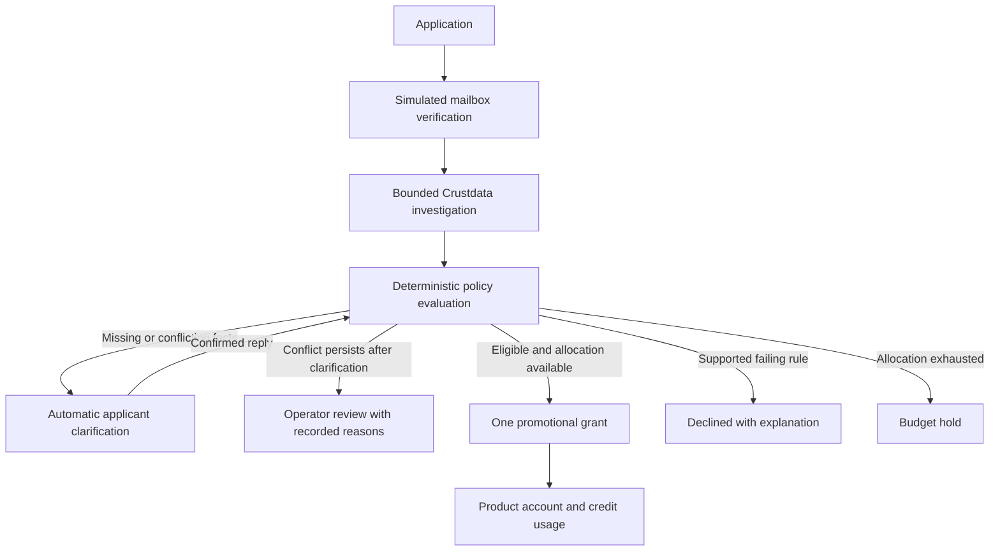

# LaunchCloud Startup Desk

**Research startup applications, clarify discrepancies automatically, and issue auditable promotional credits.**

LaunchCloud is a local startup-program operations demo built at ContextCon, IIT Kanpur. A fictional SaaS
provider offers **$500 in promotional product credits** to eligible startups. The app gathers company research,
compares it with applicant declarations, asks targeted questions, evaluates explicit policy rules, and activates
an account with a usable credit balance.

**Applicants clarify first. Operators handle conflicts that remain unresolved.** Groq can prioritize research
and suggest quote-backed facts; deterministic backend code controls eligibility, duplicate prevention, budgets,
and every grant or debit.

> This is a demonstration: the mailbox is simulated, applicant facts are declarations, and promotional credits
> exist in a local ledger. Company research corroborates claims; it is not independently verified payroll,
> funding, legal authority, or a production billing integration.

## What it does

- **Applicant workflow:** application, simulated mailbox challenge, status tracking, structured replies, and JSON export.
- **Crustdata research:** company enrichment by domain, available founding/headcount/funding observations, and
  targeted public-web searches for missing or conflicting facts.
- **Bounded investigation:** domain checks, relevant follow-up queries, a 24-hour response cache, call/spend
  limits, deadlines, and durable retries. Tool records include purpose, round, latency, status and estimated cost.
- **Automatic clarification:** the first conflict generates a bundled request. Corrections are re-evaluated
  automatically; unanswered or unrelated topics remain pending. Persistent conflicts reach the operator.
- **Groq-assisted replies:** candidate numeric facts require strict validation and exact supporting quotes.
  Applicants review and re-attest before structured corrections change the case.
- **Evidence and decisions:** declarations and provider observations remain distinct, with source references,
  effective/retrieval dates and immutable evaluation snapshots.
- **Operator desk:** queue, evidence comparison, decision history, research retry, and reasoned exception resolution.
- **Credit ledger:** one benefit per company/domain, transactional budget checks, idempotent usage, receipts,
  and balance reconciliation. A sample API job demonstrates **$500.00 → $499.00**.

## Workflow



A source disagreement is a request for clarification, not an accusation. Missing funding stays **unknown**,
never zero. Two automatic clarification rounds may introduce new conflict topics; ordinary replies do not
require an operator. Cross-domain identity collisions cannot be waived into a second benefit.

## Quick start

**Requirements:** Python **3.12+**, Node.js **22.12+**, npm, and Git. Verified locally with Python 3.13.7 and
Node.js 22.20.0. Internet access is required to install dependencies and call live providers.

```powershell
git clone https://github.com/Sha0ndeep/launchcloud-startup-desk.git
cd launchcloud-startup-desk
python run.py
```

On macOS/Linux, use `python3 run.py` if your interpreter is named `python3`. On Windows you can also
double-click **start.cmd**.

The launcher creates `.venv`, installs missing backend/frontend dependencies, starts the **API, durable worker,
and frontend**, then opens **http://127.0.0.1:5173**. Keep it running; **Ctrl+C** stops the services it started.
API documentation is at **http://127.0.0.1:8000/docs**. Logs are stored in `.local/logs/`.

| Command | Purpose |
| --- | --- |
| `python run.py --install` | Refresh Python requirements and locked npm dependencies. |
| `python run.py --no-browser` | Start without opening a browser. |
| `python run.py --api-port 8001` | Run this checkout's API on 8001 and connect the frontend to it. |
| `python run.py --reuse-api` | Start only the frontend against an already-running API and worker. |

Port 5173 is fixed to match the default CORS allowlist. The launcher reports occupied ports rather than
stopping another application. When running a second backend, also select a separate `DATABASE_PATH`.
`--reuse-api` does not upgrade the existing server's code or restart its worker.

## Configure the integrations

Copy `backend/.env.example` to **.env.local in the repository root**, then enter your own values privately.
`.env.local` is ignored by Git and is loaded by the launcher, API, and worker. Existing shell variables take
precedence. The example file itself is not loaded automatically.

```dotenv
CRUSTDATA_API_KEY=your_crustdata_key
GROQ_API_KEY=your_groq_key
GROQ_MODEL=openai/gpt-oss-120b
DEMO_MODE=true
OPERATOR_TOKEN=choose_a_local_operator_token
DATABASE_PATH=backend/data/launchcloud.sqlite3
CORS_ORIGINS=http://localhost:5173,http://127.0.0.1:5173
```

| Setting | Behavior |
| --- | --- |
| `CRUSTDATA_API_KEY` | Enables live company enrichment and targeted web search. Without it, otherwise-eligible applications remain held on research. |
| `GROQ_API_KEY` | Enables optional investigation prioritization and candidate extraction previews. Structured replies work without it. |
| `GROQ_MODEL` | Defaults to `openai/gpt-oss-120b`. No silent switch to another provider or paid model on failure. |
| `OPERATOR_TOKEN` | Session-entered operator credential. Defaults to `demo-operator` for local demonstrations. |
| `DATABASE_PATH` | SQLite database; the API and worker must use the same path. |
| `CORS_ORIGINS` | Comma-separated frontend origins. |
| `DEMO_MODE` | Must remain `true`: a production email adapter is not implemented. |

No credentials are included in this repository. Keep provider keys in server configuration, never in
`VITE_` variables or frontend code. Groq account quotas, pricing and Free-plan billing status must be checked
in your own account; this project does not claim unlimited or guaranteed free model usage.

## Demo policy

Policy v1 accepts timestamped applicant declarations for selected facts, with external observations used as
corroboration. The backend checks:

| Criterion | Requirement |
| --- | --- |
| Mailbox | Complete the explicitly simulated company-email challenge. |
| Authority and attestation | Record the applicant's declarations. |
| Product | Software product. |
| Founding year | 2021 or later, and not in the future. |
| Full-time headcount | Fewer than 50. |
| Total funding | Below US$10,000,000; missing is unknown. |
| Benefit | One $500 promotional grant, subject to identity checks and allocation. |

The initial program allocation is **$50,000**. Same-domain applications link to an existing benefit instead
of receiving a second grant. Actual balances always come from the backend.

## Frontend development fixtures

For predictable frontend-only scenarios:

```powershell
cd frontend
npm ci
npm run dev:mock
```

This mode displays a permanent **fixture data** banner. It does not contact Crustdata or Groq and does not
establish real provider behavior. Stop another server using port 5173 before starting it.
See the [frontend guide](frontend/README.md) for fixture domains. The optional
[stub-research harness](frontend/dev/stub_backend_harness.py) exercises real backend policy code with labeled
synthetic observations.

## Validation

From the repository root:

```powershell
.\.venv\Scripts\python.exe -m unittest discover -s backend/tests -v
cd frontend
npm run build
npm run lint
```

On macOS/Linux, the virtual-environment interpreter is `.venv/bin/python`.

| Check | Result verified locally |
| --- | --- |
| Backend tests | **43 passed**, with fake providers and temporary databases. |
| Frontend production build | Pass, including strict TypeScript checks. |
| Frontend lint | Pass. |
| Live Crustdata | Company enrichment and targeted web search succeeded in opt-in checks. |
| Live Groq | Quote-backed extraction and bounded planning succeeded in opt-in checks. |

Tests cover automatic clarification, resolved and persistent conflicts, partial/unrelated replies, company
mismatches, quote grounding, provider failure handling, budgets, duplicates, identity collisions, leases,
concurrent usage and immutable decision history. Unit tests consume no provider credits.

An optional live smoke check uses your configured keys, bounded provider calls, synthetic applicant declarations
and a temporary database:

```powershell
.\.venv\Scripts\python.exe -m backend.live_check --live
```

The smoke check demonstrates a clean enrollment, clarification/persistent-conflict handling, one idempotent
$1 debit, and ledger reconciliation. It does not verify account billing or prove company facts independently.

## Architecture and repository layout

**Frontend:** React 19, TypeScript, Vite, a typed API client, tab-scoped applicant/operator sessions and polling.
**Backend:** FastAPI, Pydantic, SQLite, a durable worker, Crustdata HTTP integration and optional Groq calls.

| Path | Contents |
| --- | --- |
| `backend/` | API, policy, investigation, automatic clarification, persistence, provider integration and tests. |
| `frontend/` | Applicant and operator interface, explicit mock client, and verification harness. |
| `integration/` | Shared TypeScript contract and OpenAPI snapshot. |
| `run.py`, `start.cmd` | Local setup and process supervision. |
| [API_CONTRACT.md](API_CONTRACT.md) | Endpoint/authentication rules and backward-compatible extensions. |
| [IMPROVEMENTS.md](IMPROVEMENTS.md) | Implemented roadmap scope, bounds, verification and remaining work. |
| [backend/README.md](backend/README.md) | Backend development and operational details. |
| [frontend/README.md](frontend/README.md) | Frontend development, routes, fixtures and client behavior. |

Manual development uses three processes from the repository root: `python -m uvicorn backend.main:create_app
--factory --host 127.0.0.1 --port 8000`, `python -m backend.worker`, and `npm run dev` from `frontend/`.
Use the virtual environment for Python commands. The worker is required; verified applications otherwise stay
queued. `/api/health` reports configuration readiness, and `/docs` contains the interactive API reference.

## Scope and remaining work

This is a single-program local prototype, not a production verification or billing service. It has a shared
operator token rather than operator accounts and roles. Crustdata fields are provider observations; public
search snippets remain leads. The model cannot approve, change policy, issue grants, or mutate balances.

Not implemented: real email delivery, verification-code resend, uploads/OCR, official-registry/document
verification, authenticated public-page retrieval, calibrated stale-evidence rules, multi-tenant operation,
real billing reconciliation, and WITHDRAWN/EXPIRED application states. The mailbox challenge itself can expire.

## Project history

This repository builds on the original [LaunchCloud Startup Desk](https://github.com/shivamshaw23/launchcloud-startup-desk)
from the ContextCon collaboration, preserving its Git history. This version adds Groq integration, bounded
investigation, automatic clarification before operator escalation, richer provenance, decision snapshots,
ledger reconciliation, Windows startup tooling and expanded tests.
